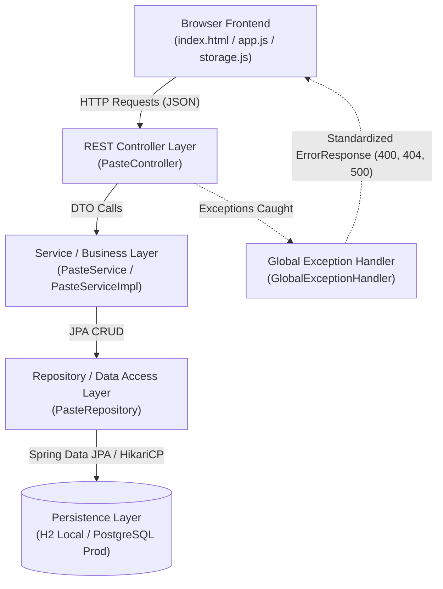
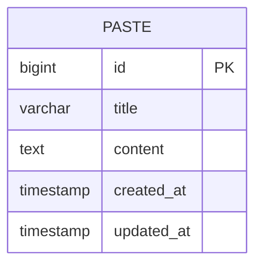

# DevVault (ai-dump-yard) — Codebase Flow & Architecture

> **DevVault** is a lightweight developer workspace and paste vault built with **Spring Boot 3.2.3 (Java 21)**, **Spring Data JPA**, **H2 Database**, and a vanilla JavaScript web client with CodeMirror 6 and Markdown preview.

---

## 1. System Architecture Overview

Data and control flow across **4 primary layers**:

---

## 2. Layer Breakdown & File Mapping

| Layer | Primary Components | Responsibility |
| :--- | :--- | :--- |
| **Presentation / Client** | [`index.html`](file:///home/akash/Documents/project/dev-vault/src/main/resources/static/index.html) [`app.js`](file:///home/akash/Documents/project/dev-vault/src/main/resources/static/app.js) [`storage.js`](file:///home/akash/Documents/project/dev-vault/src/main/resources/static/storage.js) | CodeMirror 6 editor, Markdown-it parser, Mermaid diagrams, instant LocalStorage auto-save, note search, shortcuts. |
| **API / Controller** | [`PasteController`](file:///home/akash/Documents/project/dev-vault/src/main/java/com/dumpyard/controller/PasteController.java) | REST endpoints for note CRUD running on Java 21 Virtual Threads. |
| **Domain / Service** | [`PasteService`](file:///home/akash/Documents/project/dev-vault/src/main/java/com/dumpyard/service/PasteService.java) [`PasteServiceImpl`](file:///home/akash/Documents/project/dev-vault/src/main/java/com/dumpyard/service/PasteServiceImpl.java) | Core business logic for creating, reading, listing, updating, and deleting notes. |
| **Data Access** | [`PasteRepository`](file:///home/akash/Documents/project/dev-vault/src/main/java/com/dumpyard/repository/PasteRepository.java) | Spring Data JPA interface querying entities by ID. |
| **Persistence / Model** | [`Paste`](file:///home/akash/Documents/project/dev-vault/src/main/java/com/dumpyard/entity/Paste.java) | JPA entity mapping the database table with timestamps (Hibernate `ddl-auto=update`). |
| **Exception Handling** | [`GlobalExceptionHandler`](file:///home/akash/Documents/project/dev-vault/src/main/java/com/dumpyard/exception/GlobalExceptionHandler.java) | Central advice mapping exceptions into structured [`ErrorResponse`](file:///home/akash/Documents/project/dev-vault/src/main/java/com/dumpyard/dto/ErrorResponse.java) JSON payloads. |
| **Containerization** | [`Dockerfile`](file:///home/akash/Documents/project/dev-vault/Dockerfile) [`docker-compose.yml`](file:///home/akash/Documents/project/dev-vault/docker-compose.yml) | Multi-stage lightweight Alpine JRE 21 container with PostgreSQL 16 orchestration. |

---

## 3. Entity Relationship Diagram

---

## 4. Complete REST API Reference

| Method | Endpoint | Description | Request Body | Response Body |
| :--- | :--- | :--- | :--- | :--- |
| `POST` | `/api/pastes` | Create new note | [`CreatePasteRequest`](file:///home/akash/Documents/project/dev-vault/src/main/java/com/dumpyard/dto/CreatePasteRequest.java) | [`PasteResponse`](file:///home/akash/Documents/project/dev-vault/src/main/java/com/dumpyard/dto/PasteResponse.java) |
| `GET` | `/api/pastes/{id}` | Fetch note by ID | *None* | [`PasteResponse`](file:///home/akash/Documents/project/dev-vault/src/main/java/com/dumpyard/dto/PasteResponse.java) |
| `GET` | `/api/pastes` | List all notes | *None* | `List<PasteResponse>` |
| `PUT` | `/api/pastes/{id}` | Update existing note | [`UpdatePasteRequest`](file:///home/akash/Documents/project/dev-vault/src/main/java/com/dumpyard/dto/UpdatePasteRequest.java) | [`PasteResponse`](file:///home/akash/Documents/project/dev-vault/src/main/java/com/dumpyard/dto/PasteResponse.java) |
| `DELETE` | `/api/pastes/{id}` | Delete note by ID | *None* | *204 No Content* |
